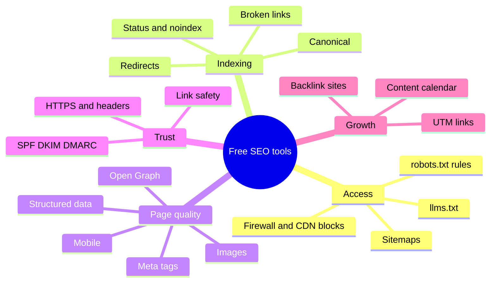

# Free SEO and AI-Visibility Tools

**23 free, open-source tools that check whether search engines and AI assistants can find, read and trust a website.** Five run in your browser, eighteen check live websites from the command line or as a Python library. No sign-up, no AI calls, nothing stored. Built and used by [CMO Owls](https://www.cmoowls.com/), 21 specialized AI marketing agents that work from one shared strategy; the same engine powers the free tools at [cmoowls.com/tools](https://www.cmoowls.com/tools/).

```bash
pip install "git+https://github.com/CMO-Owls/free-seo-tools.git#subdirectory=python"
cmoowls-seo ai-visibility example.com
```

**Try the browser tools now:** [cmo-owls.github.io/free-seo-tools](https://cmo-owls.github.io/free-seo-tools/)

> **At a glance**
> - **What it checks:** the access layer of SEO and AI search: robots.txt rules for 18 search and AI crawlers, firewall blocks, llms.txt, sitemaps, indexability, redirects, structured data, meta tags, Open Graph, images, mobile, security headers and more.
> - **How it's different:** plain-English verdicts ("Google can index this page") with the reason, instead of raw HTTP data; the same results a non-technical site owner sees on cmoowls.com.
> - **Safe by design:** every request goes through one guard layer that blocks private and internal addresses, re-checks every redirect hop and caps size and time.
> - **License:** MIT. Use it in your own scripts, audits, CI checks or products.

## Contents

- [The 23 tools](#the-23-tools)
- [Install and quick start](#install-and-quick-start)
- [Real examples](#real-examples)
- [Use it as a Python library](#use-it-as-a-python-library)
- [How the checks work](#how-the-checks-work)
- [Browser tools on GitHub Pages](#browser-tools-on-github-pages)
- [Free backlink sites dataset](#free-backlink-sites-dataset)
- [What these tools can't tell you](#what-these-tools-cant-tell-you)
- [The tools on one map](#the-tools-on-one-map)
- [FAQ](#faq)
- [Sources](#sources)

## The 23 tools

**Every tool answers one question about a site, in plain words, and says what to fix first.** The hosted versions on cmoowls.com show a visual report and link to a full guide for each topic.

| Tool | What it answers | Run it | Hosted version and guide |
|---|---|---|---|
| AI Visibility Checker | Can ChatGPT, Claude, Perplexity and Google's AI reach the site? | `cmoowls-seo ai-visibility` | [Tool](https://www.cmoowls.com/tools/ai-visibility-checker/) · [How to check AI visibility](https://www.cmoowls.com/blog/how-to-check-ai-visibility/) |
| AI Crawler Access Test | Which crawlers does the firewall or CDN turn away? | `cmoowls-seo crawler-access` | [Tool](https://www.cmoowls.com/tools/ai-crawler-access-test/) · [What is an AI crawler?](https://www.cmoowls.com/blog/what-is-an-ai-crawler/) |
| Robots.txt Generator & analyzer | Which crawlers does each robots.txt rule affect? | `cmoowls-seo robots` | [Tool](https://www.cmoowls.com/tools/robots-txt-generator/) · [What is robots.txt?](https://www.cmoowls.com/blog/what-is-robots-txt/) |
| llms.txt Generator | Build an llms.txt from the sitemap | `cmoowls-seo llms-txt --out llms.txt` | [Tool](https://www.cmoowls.com/tools/llms-txt-generator/) · [What is llms.txt?](https://www.cmoowls.com/blog/what-is-llms-txt/) |
| llms.txt Validator | Does an existing llms.txt follow the format? | `cmoowls-seo llms-validate` | [Tool](https://www.cmoowls.com/tools/llms-txt-generator/) |
| Schema Markup Checker | Is the JSON-LD valid, complete and consistent with the page? | `cmoowls-seo schema` | [Tool](https://www.cmoowls.com/tools/schema-checker/) · [What is schema markup?](https://www.cmoowls.com/blog/what-is-schema-markup/) |
| Broken Link Checker | Which links, images, scripts and stylesheets are broken? | `cmoowls-seo broken-links` | [Tool](https://www.cmoowls.com/tools/broken-link-checker/) · [What is a broken link?](https://www.cmoowls.com/blog/what-is-a-broken-link/) |
| Indexability Checker | Is Google allowed to index this page, and if not, why? | `cmoowls-seo indexability` | [Tool](https://www.cmoowls.com/tools/indexability-checker/) · [Why is my page not indexed?](https://www.cmoowls.com/blog/why-is-my-page-not-indexed/) |
| Redirect Checker | 301 or 302, chains, loops, old URLs that 404 | `cmoowls-seo redirects` | [Tool](https://www.cmoowls.com/tools/redirect-checker/) · [What is a 301 redirect?](https://www.cmoowls.com/blog/what-is-a-301-redirect/) |
| Mobile-Friendly Test | Viewport, zoom, phone vs desktop content, layout shift, speed | `cmoowls-seo mobile` | [Tool](https://www.cmoowls.com/tools/mobile-friendly-checker/) · [Make a website mobile-friendly](https://www.cmoowls.com/blog/how-to-make-a-website-mobile-friendly/) |
| Bulk Mobile-Friendly Test | The same checks for up to 5 pages | `cmoowls-seo mobile-bulk` | [Tool](https://www.cmoowls.com/tools/mobile-friendly-checker/) |
| Meta Tag Checker | Title and description by pixel width, headings, alt text | `cmoowls-seo meta-tags` | [Tool](https://www.cmoowls.com/tools/meta-tag-checker/) · [Writing meta titles and descriptions](https://www.cmoowls.com/blog/how-to-write-meta-title-and-description/) |
| Meta Tag Generator | Write the title, description, Open Graph and Twitter Card tags | Browser | [Tool](https://www.cmoowls.com/tools/meta-tag-generator/) |
| Open Graph Checker | How the link looks when shared; og:image size and shape | `cmoowls-seo open-graph` | [Tool](https://www.cmoowls.com/tools/open-graph-checker/) · [What are Open Graph tags?](https://www.cmoowls.com/blog/what-are-open-graph-tags/) |
| Image Size Checker | Every image's weight, format and dimensions | `cmoowls-seo images` | [Tool](https://www.cmoowls.com/tools/image-size-checker/) · [Image SEO](https://www.cmoowls.com/blog/image-seo/) |
| Image Compressor | Resize and convert to WebP, privately | Browser | [Tool](https://www.cmoowls.com/tools/image-compressor/) |
| Sitemap Checker | Find and validate the sitemap, spot-check listed pages | `cmoowls-seo sitemap` | [Tool](https://www.cmoowls.com/tools/sitemap-checker/) · [What is a sitemap?](https://www.cmoowls.com/blog/what-is-a-sitemap/) |
| XML Sitemap Generator | Crawl up to 150 pages into a clean sitemap.xml | `cmoowls-seo sitemap-generate --out sitemap.xml` | [Tool](https://www.cmoowls.com/tools/xml-sitemap-generator/) |
| Keyword Density Checker | Most-used words and phrases, and where they appear | `cmoowls-seo keyword-density` | [Tool](https://www.cmoowls.com/tools/keyword-density-checker/) |
| Link Safety Checker | Where a link really goes; look-alike and brand-new domains | `cmoowls-seo link-safety` | [Tool](https://www.cmoowls.com/tools/link-safety-checker/) |
| SEO Page Checker | Every on-page basic for one page, scored | `cmoowls-seo seo-page` | [Tool](https://www.cmoowls.com/tools/seo-page-checker/) · [How to do an SEO audit](https://www.cmoowls.com/blog/how-to-do-an-seo-audit/) |
| Security Headers Checker | HTTPS, security headers, cookie flags, SPF, DKIM, DMARC | `cmoowls-seo security` | [Tool](https://www.cmoowls.com/tools/security-headers-checker/) |
| UTM Builder | Clean campaign links for Google Analytics 4 | Browser | [Tool](https://www.cmoowls.com/tools/utm-builder/) |
| Social Media Calendar Template | A month of posts, spread evenly, for Sheets or Excel | Browser | [Tool](https://www.cmoowls.com/tools/social-media-calendar-template/) · [Content calendar guide](https://www.cmoowls.com/blog/how-to-create-a-content-calendar/) |
| Free Backlink Sites | 100+ checked places to list a business | Browser + [dataset](data/) | [Tool](https://www.cmoowls.com/tools/free-backlink-sites/) |

## Install and quick start

**You need Python 3.10 or newer.** The package has two dependencies, [httpx](https://www.python-httpx.org/) for requests and Pillow for reading image sizes.

1. Install from GitHub:
   ```bash
   pip install "git+https://github.com/CMO-Owls/free-seo-tools.git#subdirectory=python"
   ```
2. Run any tool with a website or page address:
   ```bash
   cmoowls-seo indexability https://example.com/pricing/
   ```
3. Add `--json` for the full machine-readable result, or `--out FILE` to save a generated llms.txt or sitemap.xml:
   ```bash
   cmoowls-seo sitemap-generate example.com --out sitemap.xml
   cmoowls-seo llms-txt example.com --out llms.txt
   ```
4. Optional: to include Google's mobile speed test in `cmoowls-seo mobile`, set your own free [PageSpeed Insights API key](https://developers.google.com/speed/docs/insights/v5/get-started) as `PAGESPEED_API_KEY`. Without it, every other mobile check still runs.

Run `cmoowls-seo --help` for the list of tools.

## Real examples

**These are unedited results from running the tools on our own site, cmoowls.com, in October 2026.**

The llms.txt validator found a real issue we hadn't noticed: our file was served through a redirect from the non-www address. (We've since changed the server to answer `cmoowls.com/llms.txt` directly, and it now passes.)

```text
$ cmoowls-seo llms-validate cmoowls.com

Your llms.txt works, with things to tidy  [improve]
  MED   The file is reached through a redirect
        https://cmoowls.com/llms.txt redirects to https://www.cmoowls.com/llms.txt. It works, but tools
        that don't follow redirects may miss it. Serve it directly at the address people request.
```

The indexability check gives one verdict from five signals (status code, robots.txt, noindex tag and header, canonical, sitemap) and is honest about what it can't know:

```text
$ cmoowls-seo indexability https://www.cmoowls.com/blog/image-seo/

Google can index this page  [good]
  INFO  Indexable isn't the same as indexed
        This shows whether Google is allowed to index the page. Google still decides whether to.
        For the final word, use URL Inspection in Google Search Console.
```

The AI visibility check reads robots.txt the way each crawler does and lists all 18, grouped into search crawlers, AI search crawlers and AI training crawlers:

```text
$ cmoowls-seo ai-visibility cmoowls.com
  Googlebot            Google         allowed, some paths blocked
  OAI-SearchBot        OpenAI         allowed, some paths blocked
  Claude-SearchBot     Anthropic      allowed, some paths blocked
  PerplexityBot        Perplexity     allowed, some paths blocked
  GPTBot               OpenAI         allowed, some paths blocked
  ...
```

("Some paths blocked" is deliberate on our site: the login and dashboard pages are disallowed for every crawler.)

## Use it as a Python library

**Every tool is an async function that takes an address and returns a JSON-serialisable dict**, so you can run checks in scripts, notebooks or CI.

```python
import asyncio
from cmoowls_seo_tools import check_indexability, validate_llms_txt

async def main():
    for url in ["https://example.com/", "https://example.com/pricing/"]:
        r = await check_indexability(url)
        print(url, r["summary"]["verdict"], r["summary"]["headline"])

asyncio.run(main())
```

Most results include a `summary` with a `verdict` (`good`, `improve` or `action_needed`), a one-line `headline` and a list of `issues`, each with a `level` (`high`, `medium`, `low`, `info`), a `title` and a plain-English `detail`. Generators return the file instead (`llms_txt`, `xml`). The robots.txt parser is also usable on its own:

```python
from cmoowls_seo_tools import parse_robots, is_allowed
rules = parse_robots("User-agent: *\nDisallow: /private/\nAllow: /private/ok\n")
group = rules["groups"][0][1]
is_allowed(group, "/private/ok")   # True: the longest matching rule wins
```

## How the checks work

**The checks fetch public pages the way a crawler does and apply the published rules**, not guesses:

- **robots.txt** follows [RFC 9309](https://www.rfc-editor.org/rfc/rfc9309.html) and [Google's robots.txt documentation](https://developers.google.com/crawling/docs/robots-txt/robots-txt-spec): the most specific user-agent group applies, the longest matching path wins, `Allow` wins a tie, and `*` and `$` wildcards work.
- **Crawler names** come from each company's own documentation, for example [OpenAI's crawlers](https://developers.openai.com/api/docs/bots), [Anthropic's crawlers](https://support.claude.com/en/articles/8896518-does-anthropic-crawl-data-from-the-web-and-how-can-site-owners-block-the-crawler) and [Google's crawlers](https://developers.google.com/crawling/docs/crawlers-fetchers/overview-google-crawlers).
- **llms.txt** is checked against the [proposal at llmstxt.org](https://llmstxt.org/); **sitemaps** against the [sitemaps.org protocol](https://www.sitemaps.org/protocol.html); **Open Graph** against [ogp.me](https://ogp.me/); **structured data** against [schema.org](https://schema.org/docs/gs.html) types.
- **The crawler access test** sends real requests with each crawler's user-agent, because a firewall or CDN can block a bot that robots.txt allows. [Cloudflare's bot documentation](https://developers.cloudflare.com/bots/concepts/bot/) explains how those blocks work.

**Safety.** A tool that fetches any address a user types is a classic server-side request forgery (SSRF) risk. Every request goes through `safe_get`, following the [OWASP SSRF prevention guidance](https://cheatsheetseries.owasp.org/cheatsheets/Server_Side_Request_Forgery_Prevention_Cheat_Sheet.html):

| Guard | What it stops |
|---|---|
| http/https only, ports 80 and 443, no credentials in the URL | Requests to other services and protocols |
| Every resolved IP must be public; the connection is pinned to the checked IP | Loopback, private networks, cloud metadata (169.254.169.254) and DNS rebinding |
| Redirects followed by hand (max 5), each hop re-checked | A public URL that redirects to an internal one |
| Streamed bodies with byte caps and hard timeouts | Huge or never-ending responses |

## Browser tools on GitHub Pages

**Five tools need no server at all**, so they run on GitHub Pages straight from the [`web/`](web/) folder: the Meta Tag Generator, Image Compressor, Social Media Calendar Template, UTM Builder and Free Backlink Sites list. Images in the compressor are processed by the browser's own canvas encoder and never uploaded. Open them at [cmo-owls.github.io/free-seo-tools](https://cmo-owls.github.io/free-seo-tools/), or open `web/index.html` locally. Each page links to its full guide on cmoowls.com.

## Free backlink sites dataset

**[`data/free-backlink-sites.csv`](data/free-backlink-sites.csv) (and `.json`) lists 100+ legitimate places to list a business for free**: launch platforms, software and AI directories, business listings, startup databases, developer and publishing platforms, communities, profiles and expert-quote sites. Every entry was opened and checked, and carries its popularity rank from the Tranco top-1M research list. Social bookmarking, classified ads, PDF dumps and paid link packages are deliberately left out because search engines treat them as link spam. The browsable version with filters is the [Free Backlink Sites page](https://www.cmoowls.com/tools/free-backlink-sites/).

## What these tools can't tell you

- **Whether a page is actually indexed or ranking.** They check whether it *can* be. Google Search Console's URL Inspection and Performance reports are the source of truth.
- **What JavaScript renders.** The checks read the HTML a server sends, like many crawlers do first. Content that only appears after scripts run may be missed (and may be missed by AI crawlers that don't run JavaScript, too).
- **Pages behind logins, cookie walls or IP allow-lists.**
- **Whether AI assistants will cite you.** Being reachable is the first step, not a guarantee. Google itself says you [don't need special files to appear in its AI features](https://developers.google.com/search/docs/appearance/ai-features); llms.txt is an open proposal, not a ranking factor.
- **Everything about a whole site at once.** Most tools check one page. For site-wide crawls, scheduled re-checks and fixes, see [CMO Owls](https://www.cmoowls.com/).

## The tools on one map



## FAQ

**Are these tools really free?**
Yes. The code is MIT licensed, and the hosted versions on [cmoowls.com/tools](https://www.cmoowls.com/tools/) need no sign-up. Nothing you check is stored.

**Do the tools use AI?**
No. Every check is deterministic code that follows published standards, so the same page always gives the same result.

**Is it safe to run these checks on any website?**
The checks only make ordinary requests for public pages, one page at a time, like a browser or search engine would. Please respect each site's terms and don't use the tools to hammer servers.

**Can I use this in my own product or agency audits?**
Yes. MIT lets you use, change and ship the code, including commercially, as long as the license notice stays in the copy you distribute.

**Why does the mobile test say the speed check is unavailable?**
Google's PageSpeed Insights needs an API key. Set `PAGESPEED_API_KEY` to your own free key and the speed test is included; the other mobile checks run without it.

**How is this different from the tools on cmoowls.com?**
It's the same engine. The website adds a visual report, explanations and full guides; this repo gives you the code to run anywhere. The hosted service also adds rate limits to keep it free for everyone.

**Which crawlers does the AI visibility check cover?**
Eighteen: Googlebot, Bingbot, Applebot and DuckAssistBot for search; OAI-SearchBot, ChatGPT-User, Claude-SearchBot, Claude-User, PerplexityBot and Perplexity-User for AI search; and GPTBot, ClaudeBot, Google-Extended, Applebot-Extended, CCBot, Meta-ExternalAgent, Bytespider and Amazonbot for AI training.

**How do I report a bug or suggest a tool?**
[Open an issue](https://github.com/CMO-Owls/free-seo-tools/issues). Please include the command and the address you checked.

## Contributing

Issues and pull requests are welcome. Run the offline tests with `pip install -e "python[test]" && pytest python/tests`. The engine in `python/src/cmoowls_seo_tools/core.py` is exported from the code that runs cmoowls.com, so fixes may be applied upstream and re-exported.

## Sources

- [RFC 9309: Robots Exclusion Protocol](https://www.rfc-editor.org/rfc/rfc9309.html), IETF, 2022
- [How Google interprets the robots.txt specification](https://developers.google.com/crawling/docs/robots-txt/robots-txt-spec), Google, 2026
- [Overview of Google crawlers and fetchers](https://developers.google.com/crawling/docs/crawlers-fetchers/overview-google-crawlers), Google, 2026
- [Overview of OpenAI crawlers](https://developers.openai.com/api/docs/bots), OpenAI, 2026
- [Does Anthropic crawl data from the web?](https://support.claude.com/en/articles/8896518-does-anthropic-crawl-data-from-the-web-and-how-can-site-owners-block-the-crawler), Anthropic, 2026
- [The /llms.txt file](https://llmstxt.org/), llmstxt.org, 2024
- [Sitemaps XML format](https://www.sitemaps.org/protocol.html), sitemaps.org, 2016
- [The Open Graph protocol](https://ogp.me/), ogp.me, 2026
- [Getting started with schema.org](https://schema.org/docs/gs.html), schema.org, 2026
- [AI features and your website](https://developers.google.com/search/docs/appearance/ai-features), Google, 2026
- [PageSpeed Insights API: get started](https://developers.google.com/speed/docs/insights/v5/get-started), Google, 2026
- [Server-Side Request Forgery Prevention Cheat Sheet](https://cheatsheetseries.owasp.org/cheatsheets/Server_Side_Request_Forgery_Prevention_Cheat_Sheet.html), OWASP, 2026
- [Bots](https://developers.cloudflare.com/bots/concepts/bot/), Cloudflare Docs, 2026
- [HTTPX](https://www.python-httpx.org/), Encode, 2026

---

Made by [CMO Owls](https://www.cmoowls.com/): 21 specialized AI marketing agents that work from one shared strategy. MIT licensed.
